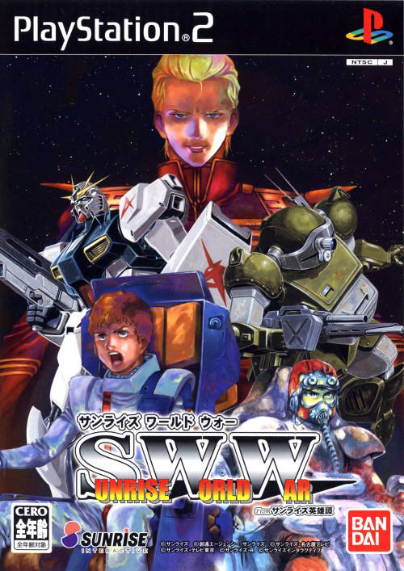

# Sunrise World War — English translation

English fan translation and tools for **Sunrise World War from Sunrise Eiyuutan** on PlayStation 2 (**Japan, SLPS-25270**).



## Contribute

Bug reports, proofreading and playtesting are welcome. Include the build version and a screenshot or the route and scene when you report a problem. You can find the team on [Discord](https://discord.gg/MssepShjmB).

## Play it

**v0.8.0** is the first private test release. It includes the translated dialogue, briefings, profiles, unit and pilot names, and interface textures from the local builds. The opening song “Destination” has spaced romaji and English subtitles. See the [release notes](docs/releases/v0.8.0.md) and [changelog](CHANGELOG.md) for coverage and known issues.

### Apply

Download `SWW-English-v0.8.0.xdelta` from [v0.8.0](https://github.com/retro-trans/Sunrise-World-War/releases/tag/v0.8.0) and apply it to your own unpacked Japanese disc image (**SLPS-25270**) with Delta Patcher or xdelta3.

```powershell
xdelta3 -d -s "Sunrise World War (Japan).iso" SWW-English-v0.8.0.xdelta "Sunrise World War EN v0.8.0.iso"
```

For a CHD, extract the disc to an ISO or BIN first. Keep checksum verification enabled and compare the source hash in the release notes if your patcher reports a mismatch. Boot the patched image fresh and load a normal memory-card save. Older save states can restore the previous executable and graphics.

## Check the translation

The English working data is stored by table and row ID. After preparing your disc, `tools/fitcheck.py` checks control codes, text encoding and layout limits. Pass a table such as `1271_10345` to check only that table. The [text inventory](docs/text_inventory.md) identifies which tables hold each kind of text.

For interface graphics, this command previews the Japanese source and the encoded English side by side. The example shows the two enemy-target badges.

```powershell
py -3.11 tools/gfx_text.py preview work/source/targets.png 6920 6921
```

## Translate it

Start with the [translation guide](docs/translation_guide.md) and [project rules](BASE_RULES.md). Run the tools from the repository root on Windows with Python 3.11. The build uses Pillow, NumPy, OpenCV, and the Noto Sans JP Variable, Lucida Console, and Consolas fonts in `C:/Windows/Fonts/`.

Put your Japanese disc dump at `Sunrise World War (Japan).iso` in the repository root. The preparation command verifies the executable, extracts the local build inputs and restores editable files from the English copies. Existing drafts are preserved.

```powershell
py -3.11 -m pip install Pillow numpy opencv-python
py -3.11 tools/prepare_source.py --write
py -3.11 tools/fitcheck.py
py -3.11 tools/build.py 0.8.1
py -3.11 tools/build.py 0.8.1 --write
```

The first build command is a dry run. The second writes a test ISO and build report under `work/output/v0.8.1/`. If that directory already holds a build, choose a new version. Run `py -3.11 tools/strip_jp.py --write` after editing to update the English-only files for Git. The release patch includes the local romaji cue sheet. Builds from the repository alone display the English song subtitles.

## What is here

| Path | Contents |
|---|---|
| [`tools/`](tools/) | Disc extraction, text and texture tooling, the builder, and emulator debug helpers |
| [`work/translation/en/`](work/translation/en/) | English dialogue, profiles, names, and system strings |
| [`work/translation/gfx/`](work/translation/gfx/) | English sprite specifications and replacement artwork |
| [`work/glossary/glossary.json`](work/glossary/glossary.json) | Project spellings and terminology |
| [`docs/translation_guide.md`](docs/translation_guide.md) | Text formats, layout limits and review workflow |
| [`docs/debug_tools.md`](docs/debug_tools.md) | Debugging workflow and runtime checks |
| [`CHANGELOG.md`](CHANGELOG.md) | Build history and known limitations |

The original disc, extracted game files, Japanese script and playable builds are local inputs or outputs. Use your own disc dump.

## Do not sell this

This is an unofficial fan translation. The game and its characters belong to their respective rights holders. Do not sell the patch or distribute pre-patched game images.

## Credits

Translation, tooling and testing by the retro-trans project. The social preview uses generated mecha artwork in the layout of the project's ACE card.

## Status

The project is in progress. v0.8.0 applies 43 translated text tables and 269 localized sprites, including 42 direct ImageGen sprite edits. Full route playtesting, some small tactical map labels, and a complete audit of movie and model textures are pending.
